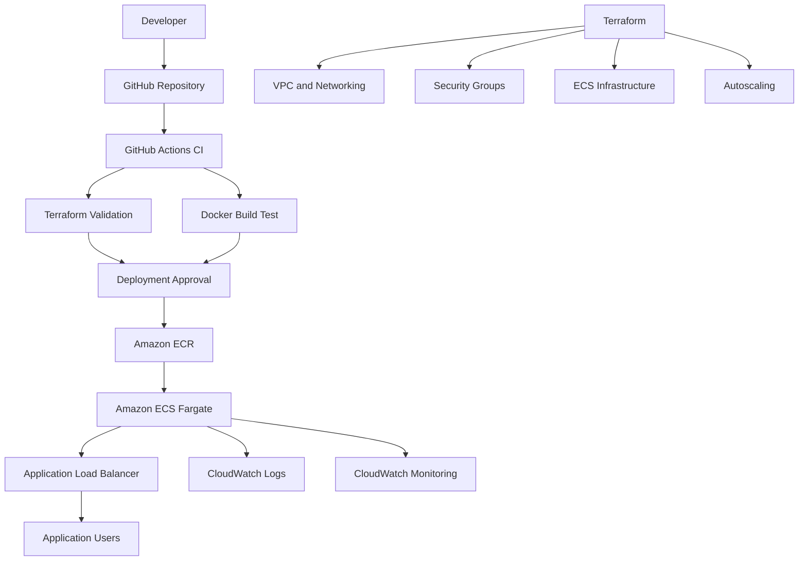

# Zero-Touch Deployments
### Terraform • GitHub Actions • AWS ECS

## 1. Project Overview

Zero-Touch Deployments is a DevOps capstone project designed to automate application infrastructure and deployment workflows using Terraform, Docker, GitHub Actions, and AWS ECS Fargate.

The objective is to reduce manual deployment operations and establish a repeatable, version-controlled CI/CD process.

**Project goals:**
- Provision AWS infrastructure using reusable Terraform modules.
- Build and validate Docker images.
- Automate infrastructure validation through GitHub Actions.
- Support separate development, staging, and production environments.
- Deploy containerized applications to Amazon ECS.
- Monitor application health and support deployment rollback.

> **Current implementation status:** Terraform and Docker CI checks are implemented. The deployment workflow currently performs configuration checks only. AWS deployment, ECR publishing, ECS updates, and rollback execution remain disabled pending cost review and explicit authorization.

## 2. Architecture

### Target Architecture



*This diagram represents the intended target architecture, not a currently deployed AWS environment.*

## 3. Technology Stack

| Technology | Purpose |
|---|---|
| Terraform | Infrastructure as Code |
| AWS | Cloud infrastructure |
| Amazon ECS Fargate | Container orchestration |
| Amazon ECR | Container image registry |
| Application Load Balancer | Application traffic routing |
| Docker | Container image creation |
| GitHub Actions | CI/CD automation |
| TFLint | Terraform linting |
| Amazon CloudWatch | Logs and monitoring |
| Ubuntu | Development environment |

## 4. Repository Structure

```text
Zero-Touch-Deployments/
├── app/
│   ├── Dockerfile
│   └── index.html
├── .github/
│   └── workflows/
│       ├── ci.yml
│       └── deploy.yml
├── docs/
├── scripts/
└── terraform/
    ├── environments/
    │   ├── dev/
    │   ├── staging/
    │   └── prod/
    ├── modules/
    │   ├── compute/
    │   ├── monitoring/
    │   ├── networking/
    │   ├── registry/
    │   └── security/
    ├── registry-bootstrap/
    ├── state-bootstrap/
    ├── backend.tf
    ├── backend.hcl.example
    ├── main.tf
    ├── outputs.tf
    ├── variables.tf
    └── versions.tf
```

## 5. Terraform Modules

| Module | Responsibility |
|---|---|
| Networking | VPC, public subnets, Internet Gateway and routing |
| Security | ALB and ECS security groups |
| Compute | ECS cluster, task definition, service and ALB |
| Registry | Amazon ECR repository |
| Monitoring | CloudWatch alarms and ECS autoscaling |

### Infrastructure Configuration

- AWS region: `ap-south-1` (Mumbai)
- ECS launch type: Fargate
- Desired ECS task count: 2
- Autoscaling minimum: 2 tasks
- Autoscaling maximum: 6 tasks
- CPU target tracking: 60%
- Memory target tracking: 75%
- CloudWatch log retention: 7 days
- NAT Gateway: Not configured
- ECS tasks: Public subnets with public IP assignment

## 6. Prerequisites

The development environment uses:

- Ubuntu
- Git
- Terraform
- AWS CLI
- Docker
- GitHub CLI

Check installed tools:

```bash
git --version
terraform version
aws --version
docker --version
gh --version
```

Authenticate with GitHub CLI:

```bash
gh auth status
```

AWS credentials and deployment permissions must be configured securely before any AWS operation.

Never commit AWS credentials, access keys, tokens, or sensitive configuration files.

## 7. Terraform Environment Setup

Move to the Terraform directory:

```bash
cd terraform
```

Format and validate the configuration without provisioning AWS resources:

```bash
terraform fmt -check -recursive
terraform init -backend=false
terraform validate
```

Create and select a workspace:

```bash
terraform workspace new staging
terraform workspace select staging
```

For an existing workspace, use `terraform workspace select` instead of creating it again.

Available environment workspaces:

- `dev`
- `staging`
- `prod`

The GitHub environment named `production` is intended to map to the Terraform workspace `prod`. These names are not interchangeable.

Example environment variable files are provided under `terraform/environments/`.

Use the appropriate example file as a starting point. Review all values before use.

## 8. Remote State and Registry Bootstrap

The project includes separate bootstrap configurations:

- `terraform/state-bootstrap/` for the S3 state bucket and DynamoDB locking table.
- `terraform/registry-bootstrap/` for ECR repository creation.

The intended remote state configuration uses:

- S3 state storage
- Bucket versioning
- Server-side encryption
- Public access blocking
- DynamoDB state locking
- Terraform native S3 lockfile support

Bootstrap resources have not been provisioned.

### Bootstrap order and workspace mapping

Do not run terraform apply until AWS cost eligibility is verified and explicit authorization is given.

1. Initialize terraform/state-bootstrap with its local backend. Review its plan for the S3 bucket and DynamoDB locking table.
2. After the state backend exists, configure terraform/registry-bootstrap/backend.hcl using its example file and initialize the remote backend.
3. Create dev, staging, and prod workspaces in the registry-bootstrap configuration. Review each workspace plan. ECR repository names use the pattern project_name-workspace.
4. Configure terraform/backend.hcl using the same state bucket and lock table. Initialize the root Terraform configuration.
5. Create dev, staging, and prod workspaces separately in the root configuration. Select the required workspace and use its matching environment variables example.

| Environment | Workspace | ECR repository |
|---|---|---|
| Dev | dev | zero-touch-deployments-dev |
| Staging | staging | zero-touch-deployments-staging |
| Production | prod | zero-touch-deployments-prod |

Workspaces belong to individual Terraform backend configurations. Creating a workspace in registry-bootstrap does not create it in the root configuration.

Example staging plan review (after backend setup):

    terraform -chdir=terraform/registry-bootstrap workspace select staging
    terraform -chdir=terraform/registry-bootstrap plan
    terraform -chdir=terraform workspace select staging
    terraform -chdir=terraform plan -var-file=environments/staging/terraform.tfvars.example

Use the corresponding dev or prod variables file for those environments. Plan review does not provision resources.

Remote backend initialization and bootstrap apply must only happen after AWS cost verification and explicit authorization.

## 9. GitHub Actions Pipeline

### Continuous Integration

Workflow: `.github/workflows/ci.yml`

Triggered by:
- Pushes to `main` and `staging`
- Pull requests targeting `main` and `staging`

Checks:
1. Checkout repository.
2. Configure Terraform.
3. Check Terraform formatting.
4. Initialize Terraform without the remote backend.
5. Validate Terraform configuration.
6. Initialize and run TFLint.
7. Build the Docker image as a test.

### Deployment Workflow

Workflow: `.github/workflows/deploy.yml`

Currently supports:
- Push to `staging`
- Manual workflow dispatch
- Staging and production environment selection
- Image tag input
- Deployment configuration checks

**Important:** This workflow is currently a safe validation-only workflow. It does not authenticate to AWS or deploy an application.

### Current Workflow Limitations

- The deployment workflow performs configuration checks only.
- It does not deploy to staging or production.
- GitHub environment branch restrictions exist, but required-reviewer approval is not configured.
- AWS authentication, ECR image publishing, ECS deployment and automated rollback are not implemented in this workflow.

### Intended Deployment Flow

1. A developer creates a pull request targeting staging.
2. GitHub Actions runs CI checks.
3. Changes are reviewed and merged into staging.
4. The future pipeline deploys the application to staging.
5. Production changes are reviewed before release.
6. A future production deployment is triggered after the required approval process.
7. ECS health checks monitor deployment health.
8. Failed deployments should roll back to a previously working task definition.

This is the target design, not a currently operational deployment pipeline. Production approval controls, deployment automation and rollback behavior require implementation and testing.

## 10. Security Considerations

- ECS inbound traffic is restricted to the ALB security group.
- The ALB accepts HTTP traffic on port 80.
- Security groups restrict direct access to ECS tasks.
- ECS task execution uses an IAM execution role.
- GitHub OIDC is the intended AWS authentication method.
- AWS credentials must never be stored in source code.
- HTTPS and certificate configuration remain future improvements.

## 11. Monitoring and Rollback

The monitoring module defines:

- ECS CPU utilization alarm.
- ECS memory utilization alarm.
- CPU-based target tracking.
- Memory-based target tracking.
- Minimum and maximum task capacity.

The ECS deployment circuit breaker is configured to enable rollback on failed deployments.

**Verification status:** Rollback timing and the assignment's 60-second recovery target have not yet been demonstrated. CloudWatch alarms are monitoring mechanisms and should not be confused with the ECS deployment rollback mechanism.

## 12. Operational Runbook

### Check Terraform configuration

```bash
cd ~/zero-touch-deployments
terraform -chdir=terraform fmt -check -recursive
terraform -chdir=terraform validate
```

### Check Git status

```bash
git status -sb
```

### Check current branch

```bash
git branch --show-current
```

### Check GitHub Actions runs

```bash
gh run list --limit 10
```

### Inspect a workflow run

```bash
gh run view RUN_ID
```

Replace `RUN_ID` with the actual GitHub Actions run ID.

### Check Docker image build

```bash
docker build -t zero-touch-app:test ./app
```

### Troubleshooting

| Issue | Recommended check |
|---|---|
| Terraform validation failure | Inspect module configuration and provider requirements |
| TFLint failure | Review reported Terraform lint findings |
| Docker build failure | Inspect Dockerfile and application files |
| Backend initialization failure | Verify backend configuration and resource availability |
| ECR image not found | Verify repository and image tag |
| ECS task unhealthy | Inspect task events, container health checks and logs |
| ALB target unhealthy | Check target group health and security group rules |

Do not run infrastructure-changing commands until cost and authorization checks are complete.

## 13. AWS Cost Considerations

The project targets AWS Mumbai (`ap-south-1`).

Potential cost-generating services include:

- ECS Fargate tasks
- Application Load Balancer
- Public IPv4 addresses
- Amazon ECR image storage
- CloudWatch logs and metrics
- S3 state storage
- DynamoDB state locking
- Data transfer

Actual costs depend on resource usage, region-specific pricing, free-plan eligibility, and available credits.

**Cost estimate: Pending verification.**

No fixed monthly cost is claimed in this document. A verified estimate must be completed before AWS provisioning.

The project is being prepared with the intention of staying within the user's available AWS Free Plan and credits. Service eligibility and credit coverage must be checked before deployment.

## 14. Current Project Status

| Deliverable | Status |
|---|---|
| Terraform module structure | Implemented |
| Terraform formatting and validation | Passing |
| GitHub CI workflow | Passing |
| Docker build test | Passing |
| TFLint in GitHub Actions | Configured |
| Terraform environment examples | Present |
| Remote state bootstrap configuration | Prepared |
| ECR bootstrap configuration | Prepared |
| README documentation | Prepared and reviewed |
| Actual AWS deployment | Disabled |
| Production approval gate | Pending |
| Automatic rollback test | Pending |
| Verified AWS cost estimate | Pending |

## 15. Author and Repository

**Project:** Zero-Touch Deployments

**Repository:** [Ridwan-36/Zero-Touch-Deployments](https://github.com/Ridwan-36/Zero-Touch-Deployments)

**Branch model:** `staging` and `main`

**Purpose:** DevOps Institute Mumbai Capstone Project 3 — Terraform, GitHub Actions and AWS ECS Zero-Touch Deployments.
